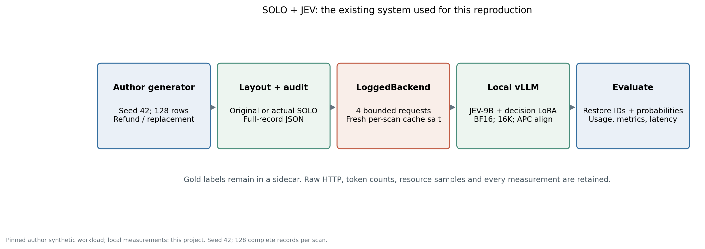
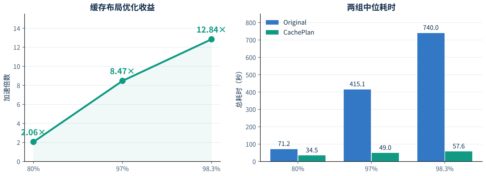
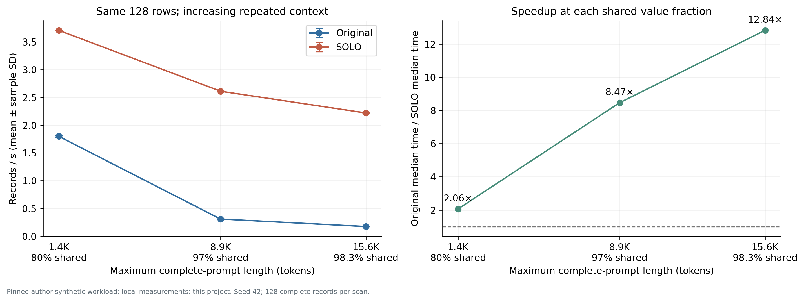

# JEV-CachePlan

**面向批量结构化语义决策的前缀缓存感知布局优化**

*Prefix-Cache-Aware Optimization for Structured Semantic Decision Making*

[English](README_EN.md) · [部署说明](docs/deployment.md) · [实验复现](docs/benchmark.md) · [架构与归属](docs/architecture.md)

JEV-CachePlan 将 **SOLO 的字段/行布局优化**接入 **JEV-9B + vLLM**，提供完整输入序列化、真实决策概率解析、有界并发、ID 对齐、结果恢复，以及真实 Prefix Cache 与性能指标采集。它面向一批记录共享较长政策、服务或产品上下文的决策工作负载。




## Motivation

批量语义判断通常只输出一个决策 Token，却反复输入长上下文。Prefix Cache 只能复用相同的连续前缀：重复字段出现在唯一 ID 之后时，相同字段值未必能成为可复用前缀。SOLO 将合适的共享字段提前，并调整请求行序；JEV-CachePlan 执行真实计划，将结果恢复到输入记录。

## Key Features

- **真实 JEV Backend/Adapter**：Noul、Choice、Score；bare-v1 Prompt、决策 LoRA、候选单 Token logprobs 与固定校准。
- **计划与执行分离**：Original / Full SOLO 对照，完整字段保真，合法置换检查。
- **结果恢复**：按计划位置收集异步返回，再恢复概率矩阵、标签、记录 ID；失败响应不转成默认答案。
- **可核验测量**：逐响应 usage、真实 cached_tokens、Prometheus `/metrics`、延迟分布和 GPU 资源采样。
- **可重跑的作者基准**：128×10、seed=42，80% / 97% / 98.3% 三组共享程度，14 轮原始实测指标随仓库提供。
- **CPU 优先**：离线示例与 FakeBackend 测试不加载 GPU、不下载模型；GPU 服务单独安装、只监听本机、使用原上游所有权控制器停服。

## Installation

CPU 客户端验证环境为 Python **3.12.3**；支持范围见 `pyproject.toml`。Linux GPU 部署单独说明，不修改系统 CUDA/驱动。

```bash
# 在仓库根目录；仅创建项目专属 CPU 环境
bash scripts/install_cpu.sh
source .venv-cpu/bin/activate
```

脚本安装 `requirements.txt`：NumPy/Numba/Pandas/Requests、测试与数据生成工具，以及固定 commit 的 SOLO Git 依赖。**不安装 PyTorch/vLLM，不下载 JEV 权重**。已有环境不会被安装脚本覆盖。

## Quick Start — CPU，无需模型

```bash
python scripts/cpu_example.py
python scripts/decide.py --compare --plan-only
PYTEST_DISABLE_PLUGIN_AUTOLOAD=1 python -m pytest -q
```

第一条检查同一份数据的字段/行布局、内容保真和原位置恢复，明确输出 `inference_executed: false`；第二条只展示实际 Original/SOLO 计划。测试 HTTP 使用显式 FakeBackend，禁止真实网络调用。

## Quick Start — 真实 JEV 决策

需要用户预先取得固定版本模型、单独 GPU 环境与足够安全显存。模型与环境均不在仓库中；完整步骤见[部署说明](docs/deployment.md)。

```bash
# 显式获取固定版本作者部署控制器/生成器（不含模型）
python scripts/fetch_solo.py
# 已有合法本地模型：此变量可指向任意路径，无须再次下载
export JEV_MODEL_DIR=/path/to/JEV-9B
export JEV_GPU=0
export JEV_PORT=18765
export JEV_GPU_PYTHON="$PWD/.venv-gpu/bin/python"
python scripts/verify_model.py
bash scripts/start.sh

# 单条、批量优化、两组对照；真实输出写入唯一 runs/example_* 目录
python scripts/decide.py --limit 1
python scripts/decide.py --method solo
python scripts/decide.py --compare

# 只停止当前固定 checkout 的自有服务
bash scripts/stop.sh
```

环境变量可覆盖模型路径、GPU、端口和配置路径（`JEV_CONFIG`）。示例 `JEV_GPU=0` 不表示该 GPU 空闲或保留给项目；启动前检查预算与余量，不能停止其他人的任务。使用已有模型时不执行任何下载命令。

## Benchmark — 本机真实测量

| 可复用字段值 Token 占比 | 每方法重复 | 最大完整 Prompt | Original 中位耗时 (s) | SOLO 中位耗时 (s) | 加速比 |
|---|---:|---:|---:|---:|---:|
| 80% | 2 | 1,401 | 71.170 | 34.510 | **2.06×** |
| 97%（核心） | 3 | 8,881 | 415.072 | 48.999 | **8.47×** |
| 98.3%（拓展） | 2 | 15,611 | 740.008 | 57.648 | **12.84×** |

共享比例是 NDV 小于行数的字段值 Token 占总字段值 Token 的比例，**不是 vLLM 实际缓存命中率**。核心 SOLO 实际缓存比例：`1,016,928 / 1,136,750 = 89.45924785572905%`；Original 为 0。14 次扫描、1,792 次正式决策，均通过 ID/概率/标签恢复检查；三组合成退款/换货任务 Accuracy 均 100%，不能外推真实业务能力。




测量：单张 **NVIDIA L40（共享服务器）**；BF16、JEV 固定 revision、vLLM 0.31.0、Torch 2.13.0+cu130、Transformers 5.17.0；16K 上下文、4 并发、batch_tokens=2048、APC、hybrid align、eager。原测量 GPU memory utilization=0.4661，每轮独立 cache_salt，预热另盐，实际 usage 与 metrics 一致。报告速度比为 **Original/SOLO 中位耗时之比**。

全部 14 轮精确值见 [run_metrics.csv](benchmarks/results/run_metrics.csv)，含规划/恢复耗时、延迟、吞吐、真实缓存、质量和输入来源哈希；实际配置、完整行列计划及诊断也已附。作者 RTX4090 的公开数值没有混入本机实测 CSV。

### 适用边界

这是作者 ID-first、长中性填充的合成基准，原始字段和顺序保持作者设置；不是刻意打乱现实数据来构造加速。只有一个主要任务/种子，核心 3 次、拓展 2 次，且共享 GPU 存在资源干扰。原运行有一次采样最低空闲 3924 MiB，低于当时 4096 MiB 启动余量；完整保留该观察，新部署示例提高启动余量，**不是重新测量或改写旧结果**。

历史 ContractNLI 全文实验中 Original/SOLO 时间比约 **0.3591×**，SOLO 反而更慢；原始合同布局已有较好前缀局部性。见[边界摘要](benchmarks/results/contractnli_boundary.json)。本项目不保证所有任务加速，也没有证明所有收益仅来自某个独立因果因素。

## Reproducibility

```bash
# 不需 GPU，读取仓库中已公开的 14 轮指标
python scripts/benchmark.py analyze

# 已配置本地 tokenizer/权重和固定作者源码；生成数据，不推理
python scripts/benchmark.py prepare

# 已按部署说明启动自有服务；唯一新 session，不覆盖历史结果
python scripts/benchmark.py run --stop-service
```

`prepare` 使用固定作者 `demo.shared`，检查规范数据 SHA256 与已有三组记录一致，保存完整 Prompt 长度，超长即报错、不截断。`run` 执行 Original/SOLO 交替顺序、隔离缓存、14 次扫描，并在 `finally` 中按选项停止自有服务。详细协议、计时口径和公开版差异见[实验说明](docs/benchmark.md)。

## Repository

```text
src/          自有 Adapter、计划执行、校验、真实指标及恢复
scripts/      CPU示例、决策、固定上游获取、服务与实验入口
configs/      可移植示例配置、固定模型文件校验清单
tests/        禁止真实网络的CPU测试和小型决策元数据fixture
benchmarks/   作者数据参数/哈希、14轮精确实测、计划与审计摘要
assets/       原测量生成的架构/布局/缓存/性能图
requirements/ CPU/GPU分离依赖及原测试环境冻结快照
docs/         架构、部署、实验与第三方许可说明
```

模型、环境、运行日志、PID、Token、缓存和第三方 Git checkout 均不纳入 Git。发行版只提供小型合成示例、可重新生成的基准方法及紧凑测量结果，不分发 ContractNLI 等第三方数据。

## Acknowledgements / References

- [SOLO 固定源码](https://github.com/0814wdwd/solo_jev/tree/c5bed0511f3c90a83774f1a01e37da6b0b60fa22)，MIT；基础布局算法、Backend 协议与 shared 生成器来自作者。
- Yingze Li et al., [*Prefix-Cache-Aware Data Reordering for LLM-Augmented Database Analytics*](https://proceedings.mlr.press/v306/li26gn.html), ICML 2026。本文研究与作者 JEV 演示基准应分开理解；本项目没有复现论文全部 Qwen/LOTUS 主表。
- [AutoTrust JEV-9B](https://huggingface.co/autotrust/JEV-9B/tree/b63f651ce8ed64481d3f5e73ecdb05f740042f01)，固定模型及决策 LoRA，模型卡声明 Apache-2.0。
- [vLLM](https://github.com/vllm-project/vllm)，Apache-2.0；GPU 推理与 Prefix Cache。

自有代码采用 [MIT](LICENSE)。第三方组件遵循原许可；fixture 的 JEV 决策元数据按 Apache-2.0 单列，详见[第三方声明](docs/third_party.md)。不以本项目许可证覆盖第三方版权。
