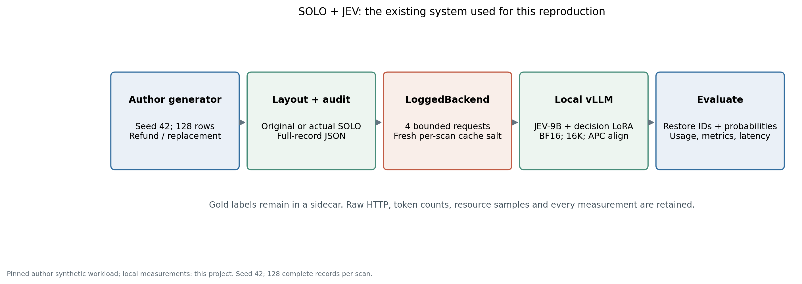
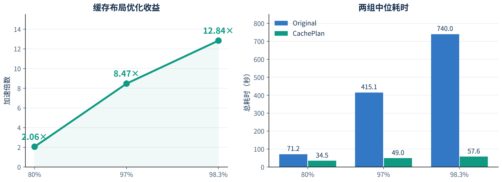

# JEV-CachePlan

**Prefix-Cache-Aware Optimization for Structured Semantic Decision Making**

[中文说明与完整命令](README.md)

JEV-CachePlan integrates the **existing layout optimizer** with **JEV-9B and vLLM** for batched structured semantic decisions. It provides audited HTTP requests, calibrated probabilities, row/column permutation validation, bounded concurrency, original-ID restoration and actual prefix-cache/performance measurements.



## CPU quick start

```bash
bash scripts/install_cpu.sh
source .venv-cpu/bin/activate
python scripts/cpu_example.py
python scripts/decide.py --compare --plan-only
PYTEST_DISABLE_PLUGIN_AUTOLOAD=1 python -m pytest -q
```


## GPU decisions

Follow [deployment](docs/deployment.md) to configure a separate GPU environment, existing local weights at revision `b63f651ce8ed64481d3f5e73ecdb05f740042f01`, selected GPU and loopback port. Then:

```bash
python scripts/fetch_solo.py
export JEV_MODEL_DIR=/path/to/JEV-9B
export JEV_GPU=0
python scripts/verify_model.py
bash scripts/start.sh
python scripts/decide.py --limit 1
python scripts/decide.py --compare
bash scripts/stop.sh
```

Noul, Choice and Score are supported by the fixed upstream decision protocol. The client reads only small head/calibration metadata; model loading occurs in the separate vLLM service. Stop checks checkout/PID/process group/start ticks via the pinned upstream controller.

## Measured benchmark

| Reusable field-value tokens | Repeats per method | Median time speedup |
|---|---:|---:|
| 80% | 2 | 2.06× |
| 97% (core) | 3 | 8.47× |
| 98.3% (extension) | 2 | 12.84× |

14 scans, 1,792 real decisions; 128×10 synthetic author-generated records per case, seed 42. Core actual cached prompt tokens: **1,016,928 / 1,136,750 = 89.46%**. The 80/97/98.3% labels describe reusable cell-value token fractions, **not observed cache-hit rates**. Accuracy is 100% on this simple synthetic refund/replacement task, not a real-world accuracy claim.

Measured on one shared NVIDIA L40 with BF16 JEV-9B, vLLM 0.31.0, Torch 2.13.0+cu130, Transformers 5.17.0, 16K context, concurrency 4 and APC enabled. Each scan uses a fresh cache salt and separate warm-up namespace. Exact per-run results, configurations, layouts and limitations are in [benchmarks/results](benchmarks/results) and [benchmark documentation](docs/benchmark.md). Published author measurements are not mixed with local observations.



This author workload is ID-first with synthetic long padding. Historical ContractNLI measurements regressed (Original/SOLO time ratio approximately 0.3591×), demonstrating that already prefix-local inputs may not benefit. Shared GPU interference and small repeat counts limit generalization. No universal speedup or original algorithm claim is made.

```bash
python scripts/benchmark.py analyze       # saved metrics only, no GPU
python scripts/benchmark.py prepare       # existing local tokenizer, no inference
python scripts/benchmark.py run --stop-service  # explicitly requested new GPU measurements
```

## Attribution and licensing

Original project code is MIT. SOLO algorithm/generator/client are [upstream MIT](https://github.com/0814wdwd/solo_jev); model/decision metadata are [AutoTrust JEV-9B, Apache-2.0](https://huggingface.co/autotrust/JEV-9B); vLLM is Apache-2.0. See [third-party notices](docs/third_party.md).

Reference: Yingze Li et al., [*Prefix-Cache-Aware Data Reordering for LLM-Augmented Database Analytics*](https://proceedings.mlr.press/v306/li26gn.html), ICML 2026. This repository reproduces the author's later JEV synthetic demonstration on different hardware, rather than every Qwen/LOTUS experiment in that paper.
