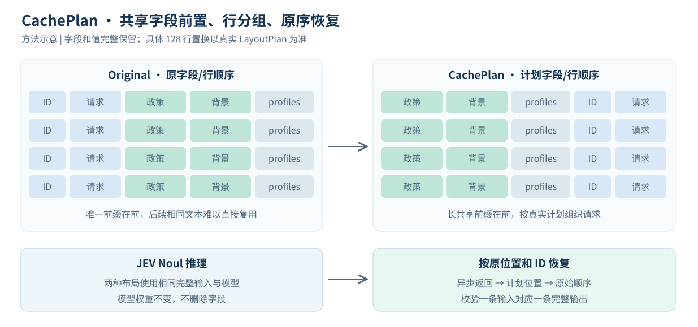
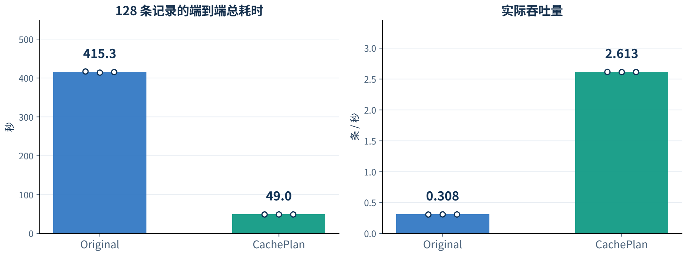

# JEV-CachePlan

**Prefix-cache-aware layout optimization for batch semantic decisions**

JEV-CachePlan integrates a published prefix-cache-aware reordering method with JEV-9B and vLLM. The system measures how input layout affects prefix-cache reuse, elapsed time, and result restoration on a synthetic refund-intent workload.

[中文](README.md) · [Architecture](docs/architecture.md) · [Deployment](docs/deployment.md) · [Benchmark](docs/benchmark.md) · [Dependencies and credits](docs/third_party.md)

| 97% core configuration | Measured core cache fraction | 98.3% extension |
| --- | --- | --- |
| **8.47×** speedup by median scan time | **89.46%** of prompt tokens cached | **12.84×** speedup by median scan time |

## JEV and repeated prefill

JEV-9B returns decision probabilities for a structured record and a question. Its model card describes Noul (binary decisions), Choice, and Score. The reported performance benchmark uses **Noul only** to determine whether a customer requests a monetary refund.

Many requests share the same company policy and service context. vLLM can reuse KV cache entries for matching contiguous token prefixes. A unique `record_id` or request near the front makes later shared text harder to reuse.

## CachePlan method

**Original** keeps the input column and row order. **CachePlan** moves long repeated fields forward and groups records with similar prefixes. The layout plan then restores results to the original record order. Both methods use the same complete field values, question, model, and inference settings. Model weights and the decision LoRA come from pinned revisions.



*Method illustration. See [layout details](docs/method.md) for the actual permutations and field statistics.*

## System architecture


*System illustration. The integration covers single-GPU serving, complete record serialization, bounded concurrency, single-token probability parsing, ID and position restoration, and cross-checks for cache and performance metrics.*

One measured synthetic request includes “The item arrived broken. Please return the money I paid to my card.” The fixed question is `Does the customer_request ask for a monetary refund?`. Original returned **True**, with `P(True) = 0.998853`; CachePlan also returned **True**, with `P(True) = 0.999429`. Inference used the full record, including the shared policy and service context. See the [paired output examples](docs/benchmark.md#正确性与恢复).

## Synthetic refund-intent benchmark

Each configuration has **128 records × 10 fields**, with 64 refund and 64 replacement examples at `seed=42`. The fields are `record_id`, `customer_request`, `company_policy`, `service_context`, and `profile_0` through `profile_5`. Labels are held separately for evaluation.

Measurements used one NVIDIA L40, BF16, vLLM 0.31.0, a 16,384-token context, four in-flight requests, and automatic prefix caching (APC). Each scan used a distinct `cache_salt` and the methods alternated order. The benchmark comprises **14 complete scans and 1,792 measured decisions**. The 80%, 97%, and 98.3% settings describe reusable field-value token shares. The actual cache-hit fraction comes from vLLM responses.

| Reusable field-value tokens | Maximum full prompt | Scans per method | Original median | CachePlan median | Median time ratio |
| --- | ---: | ---: | ---: | ---: | ---: |
| 80% | 1,401 | 2 | 71.170 s | 34.510 s | 2.06× |
| 97% (core) | 8,881 | 3 | 415.072 s | 48.999 s | **8.47×** |
| 98.3% (extension) | 15,611 | 2 | 740.008 s | 57.648 s | **12.84×** |

## Measured results and correctness



- **Core scan time and throughput.** The three-run mean fell from **415.265 s** to **48.990 s**, a reduction of approximately **88.2%**. Mean throughput increased from approximately **0.308** to **2.613 records/s**. The **8.47×** speedup uses the median time ratio above.
- **Cache reuse.** Both layouts used **1,136,750 prompt tokens per scan**. Original had zero cached tokens. CachePlan reused **1,016,928 tokens (89.46%)**. Response `usage` and server `/metrics` deltas agreed on each scan. [Cache chart](assets/cache.png)
- **Request latency.** Across 384 core requests per method, mean client latency fell from **12.848 s** to **1.519 s**. [Latency distribution](assets/latency.png) · [Three repeated comparisons](assets/repeat_timing.png)
- **Result restoration.** All 14 scans passed ID, probability, and label restoration checks. Restored predictions agreed in all seven pairs, and both layouts achieved **100% accuracy** on the synthetic labels. Probabilities could vary by layout. Performance and accuracy claims apply to this synthetic workload.

[Sharing sweep](assets/speedup.png) · [Published metrics for all 14 scans](benchmarks/results/run_metrics.csv) · [Protocol, layout plans, and audit](docs/benchmark.md)

## Quick start

The CPU commands exercise layout and restoration in a project-local client environment.

```bash
bash scripts/install_cpu.sh
source .venv-cpu/bin/activate
python scripts/cpu_example.py
python scripts/decide.py --method cacheplan --plan-only
python scripts/decide.py --compare --plan-only
python scripts/benchmark.py analyze
PYTEST_DISABLE_PLUGIN_AUTOLOAD=1 python -m pytest -q
```

With pinned local JEV-9B weights and a running service, follow the [deployment guide](docs/deployment.md) and run the Noul examples.

```bash
python scripts/decide.py --method cacheplan
python scripts/decide.py --compare
```

The legacy `--method solo` spelling remains available. Existing JSON `method` IDs and artifact filenames stay compatible, and the CLI reports the public name in `display_name`.

## Credits

The project contributes a measurable integration of the pinned model, decision LoRA, and published layout optimizer, plus reproducible execution of a public synthetic workload, restoration checks, and locally measured results. See the [sources and licenses](docs/third_party.md) and the [mapping to the 21-slide presentation](docs/PRESENTATION_ALIGNMENT.md).
