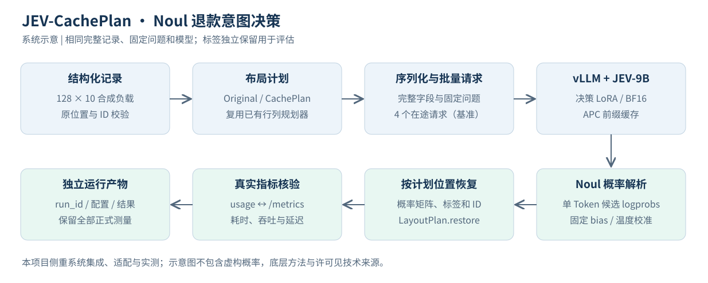
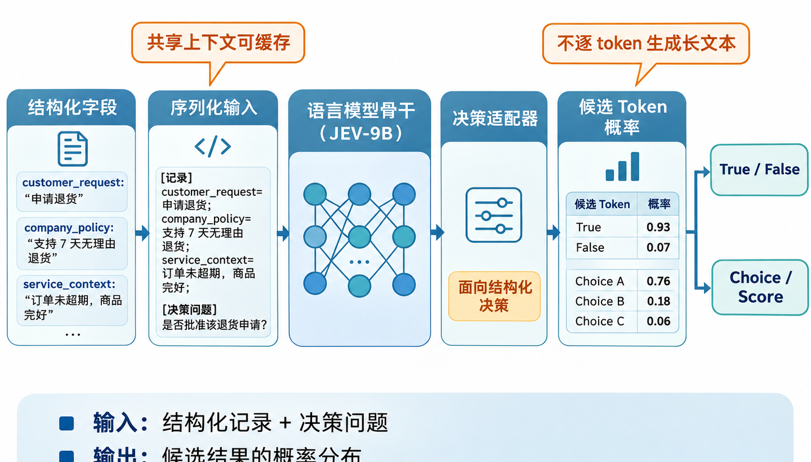

# JEV-CachePlan 系统架构

系统示意对应课程汇报第 3、6、8 页。Original 字段/行序与 CachePlan 置换都通过同一序列化、推理和恢复管线。正式基准使用 Noul 二元决策。

## 模型决策路径

图复用最终汇报第 3 页，属于概念示意。图内概率不是本次测量；本项目基准只运行 Noul 退款意图，Choice/Score 不列为此次性能结论。

1. 将完整结构化记录与固定问题序列化。标签存放在独立的评估文件中。
2. 本机 vLLM 加载固定的 JEV-9B 和决策 LoRA，按候选 Token 约束请求，返回单 Token logprobs。
3. 上游后端结合决策头偏置和温度，将候选分数换算为按 `[False, True]` 排列的概率。项目适配器记录 HTTP 响应并校验失败与异常。
4. 客户端按计划位置收集异步返回。`row_order[j] = i` 表示把第 `j` 个计划结果写回第 `i` 个原位置。概率矩阵、标签、响应和记录 ID 分别恢复，再检查顺序和一一对应。
5. 按请求采集 `usage` 与客户端延迟，并用 vLLM 的 `/metrics` 差值核查缓存 Token 数。实验报告整轮耗时、吞吐和准确率。

## 代码模块

| 模块 | 职责 |
| --- | --- |
| 固定版本的 `solo-layout` 依赖 | 提供公开的布局算法及 `LayoutOptimizer`、`LayoutPlan`、序列化器和 JEV 后端 |
| [`src/adapters/jev_adapter.py`](../src/adapters/jev_adapter.py) | HTTP 审计、请求上下文、限时与错误处理 |
| [`src/layout/execution.py`](../src/layout/execution.py) · [`validation.py`](../src/layout/validation.py) | 外部计划执行、位置恢复及置换校验 |
| [`src/evaluation/solo_reproduction.py`](../src/evaluation/solo_reproduction.py) | 共享上下文基准的完整输入、4 并发、缓存隔离及结果恢复 |
| [`src/evaluation/telemetry.py`](../src/evaluation/telemetry.py) · [`classification.py`](../src/evaluation/classification.py) | 服务端指标、GPU 采样及分类质量 |
| [`scripts/benchmark.py`](../scripts/benchmark.py) · [`service.py`](../scripts/service.py) | 14 次正式扫描的编排、固定配置、显存与端口检查 |

普通示例使用 2 个在途请求，正式 Shared Context 基准使用 4 个。CPU 客户端和测试可离线运行，测试用的 FakeBackend 不参与公开实测指标。GPU 端运行固定版本的服务，模型与数据约束见 [部署说明](deployment.md) 和 [实验复现](benchmark.md)。

[方法与实际布局](method.md) · [技术出处与许可证](third_party.md)
