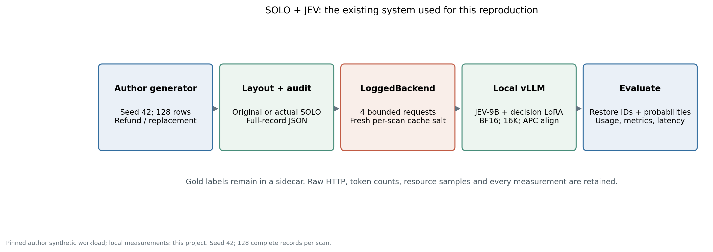

# 系统架构与代码归属

| 模块 | 职责/归属 |
|---|---|
| 外部solo-layout Git依赖 | SOLO作者算法、LayoutOptimizer/Plan、Serializer、DecisionSpec与JevBackend；固定commit，不复制改名 |
| src/adapters/jev_adapter.py | 项目HTTP审计、线程上下文、受限重试/超时、错误传播；复用上游概率解析 |
| src/layout/execution.py | M1外部计划执行与2并发、ID/概率恢复；不是修改DecisionEngine.scan支持外部计划 |
| src/layout/validation.py | schema/置换/概率合法性检查 |
| src/evaluation/solo_reproduction.py | 保留M3核心4并发测量、完整输入校验、cache_salt隔离与位置恢复 |
| src/evaluation/telemetry.py | 从原ContractNLI执行器抽取原Meter/ResourceSampler类；真实metrics/GPU采样 |
| src/evaluation/classification.py | Accuracy/F1/混淆矩阵 |
| src/data/contractnli.py | 原字段白名单与Prompt工具，只含代码，不分发数据集 |
| src/project_runtime.py | 公开版根目录解析、配置与路径，不依赖原服务器或历史会话 |
| scripts/benchmark.py | 固定作者生成器调用、独立新会话与14轮顺序、保存结果/统计 |
| scripts/service.py | 配置/显存/端口检查，调用作者原PID所有权控制器 |

异步响应按**计划位置**放置，`row_order[j]=i`表示第j个计划结果应写回第i个原位置。分别恢复二维概率、一维标签、响应和ID，再校验ID完全对齐；不能按HTTP完成顺序直接拼接。

客户端不导入Torch/vLLM；GPU服务在单独环境。CPU测试提供显式FakeBackend，绝不把Fake输出列入真实性能结果。真实公开结果来自原14轮文件，仅去除路径/UUID等发布无关字段；本次整理没有再次执行GPU推理。

公开版新增可移植入口以代替课程工程的环境和历史会话绑定。原始研究工程保持只读；公开版修改仅涉及根路径、配置、数据位置、telemetry抽取和入口组织，布局算法保持固定上游实现。
