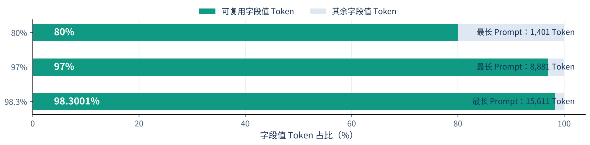

# JEV-CachePlan 退款意图基准

## 数据与协议

用固定版本的公开生成器 `demo.shared(128, ratio, 42, count)` 构建三个 Shared Context 合成设置。每档 128 条记录、10 个字段，退款和换货各 64 条。字段与重复度见 [方法说明](method.md)。固定 Noul 问题为 `Does the customer_request ask for a monetary refund?`，候选顺序为 `[False, True]`，标签单独保存供评估。

可复用字段值 Token 占比是 NDV 小于行数的所有字段值 Token 数除以全部字段值 Token 数，口径仅含字段值。缓存比例另用真实缓存 Token 除以完整 Prompt Token 数。 [生成参数与数据哈希](../benchmarks/dataset_manifests.json) · [三档字段统计](../benchmarks/dataset_statistics.csv)



Original 使用生成器原行列顺序。CachePlan 使用实际布局置换，输出按原 ID 和位置恢复。两组共用完整字段值、问题、模型及服务参数。实测为单张 NVIDIA L40、BF16、JEV-9B 固定版本及决策 LoRA、vLLM 0.31.0、Torch 2.13.0+cu130、Transformers 5.17.0、上下文 16,384、4 个在途请求、最大批次 2,048 Token、APC、hybrid align 和 eager。

核心 97% 每方法 3 次，配对顺序 Original → CachePlan、CachePlan → Original、Original → CachePlan。80% 和 98.3% 每方法各 2 次，也交换顺序。每次 128 条，合计 **14 次扫描、1,792 次正式决策**。每次正式扫描独立 `cache_salt`，预热另用盐；开场做新盐、同盐、另一新盐的隔离探针。56 次预热与 3 次探针不计入正式扫描。设 `max_tokens=1`，固定请求种子 0。 [实际运行配置](../benchmarks/results/run_configurations.json)

## 耗时、吞吐与缓存

| 可复用字段值 Token 占比 | 最大完整 Prompt | 每方法扫描 | Original 中位耗时 | CachePlan 中位耗时 | 中位耗时之比 |
| --- | ---: | ---: | ---: | ---: | ---: |
| 80% | 1,401 | 2 | 71.170 s | 34.510 s | 2.06× |
| 97%（核心） | 8,881 | 3 | 415.072 s | 48.999 s | 8.47× |
| 98.3%（拓展） | 15,611 | 2 | 740.008 s | 57.648 s | 12.84× |

实测图表均来自本项目的已完成测量。 [三档结果图](../assets/speedup.png) · [14 次扫描全精度指标](../benchmarks/results/run_metrics.csv) · [原始公开汇总](../benchmarks/results/analysis_summary.json)

- 核心三轮的 **平均**耗时为 Original **415.265 s**、CachePlan **48.990 s**，均值降低约 **88.2%**。平均吞吐约 **0.308 → 2.613 条/秒**。加速比 **8.47×** 使用两组中位耗时。 [平均耗时与吞吐](../assets/core_timing_throughput.png)
- 核心每次扫描，两组完整 Prompt 均为 **1,136,750 Token**。Original 实际命中 0，CachePlan 命中 **1,016,928（89.46%）**。逐响应 `usage` 与服务端 Prometheus `/metrics` 差值逐轮一致。 [缓存图](../assets/cache.png)
- 核心每方法有 384 个逐请求观测。客户端平均延迟从 **12.848 s** 降至 **1.519 s**，包含 HTTP 和响应解析。 [延迟分布](../assets/latency.png)
- 核心三次配对加速为 **8.51×、8.45×、8.47×**。这些是描述性复测。 [三轮复测图](../assets/repeat_timing.png)

整轮时间覆盖规划、DataFrame 归一化、完整序列化与校验、有界 HTTP 执行及结果恢复。服务启动、预热、布局解释、指标等待、质量计算和落盘在计时窗口外。Records/s = 128 ÷ 整轮时间，Input Tokens/s 使用完整输入 Token 数。实际布局计划中的 `adjacent_prefix_bytes` 衡量结构化字节前缀，实际缓存计数取自响应。

## 正确性与恢复

下面是 97% 第一轮对应记录的实际概率。只节选客户请求，推理输入包含全部字段。

公开的 [逐页证据摘要](presentation_evidence.json) 保留样例的原位置、两组 run_id、完整精度概率和源预测文件 SHA256；它是既有结果的导出，不是新推理。

| 客户请求节选 | Original P(True) | CachePlan P(True) | 两组标签 |
| --- | ---: | ---: | --- |
| The item arrived broken. Please return the money I paid to my card. | 0.998853 | 0.999429 | True |
| Please send a replacement of the same model. | 0.000852 | 0.000281 | False |

14 次扫描均完成输入保真、ID、概率和标签恢复校验。7 个配对各 128 条，恢复后预测全部一致，两种布局的合成标签准确率均为 100%。公开资料包含聚合审计和完整置换。 [响应核验摘要](../benchmarks/results/raw_response_validation.json) · [实际布局计划](../benchmarks/results/layout_plans.json) · [正确性图](../assets/quality.png)

## 查看历史指标或复测

仅从已发布 CSV 汇总历史结果：

```bash
python scripts/benchmark.py analyze
```

准备固定模型并按 [部署说明](deployment.md) 配置服务后，可在新会话测量：

```bash
python scripts/fetch_solo.py
python scripts/verify_model.py
python scripts/benchmark.py prepare
bash scripts/start.sh
python scripts/benchmark.py run --stop-service
```

`prepare` 核对固定生成结果和 tokenizer 的指纹，已有数据会验证后复用。新结果写入独立的 `runs/shared_<uuid>`，可用 `analyze --session runs/shared_<uuid>` 汇总。历史 CSV 和底层依赖沿用兼容标识 `original` / `solo`，分别对应 Original / CachePlan。

## 适用边界

结果限于三个合成配置和单一随机种子。历史实测在共享 L40 上进行，显存利用率配置为 0.4661，启动余量 4,096 MiB；公开部署示例提高到 5,120 MiB。共享资源波动详见 [运行条件记录](../benchmarks/results/runtime_margin_observations.json)。八张结果图来自既有证据，发布对齐没有重新测量 GPU。

历史 ContractNLI 是额外探索。原始合同顺序已有较好的共享前缀，该负载中 CachePlan 未改善总耗时，平均耗时之比约 0.3591×。 [历史边界记录](../benchmarks/results/contractnli_boundary.json)
