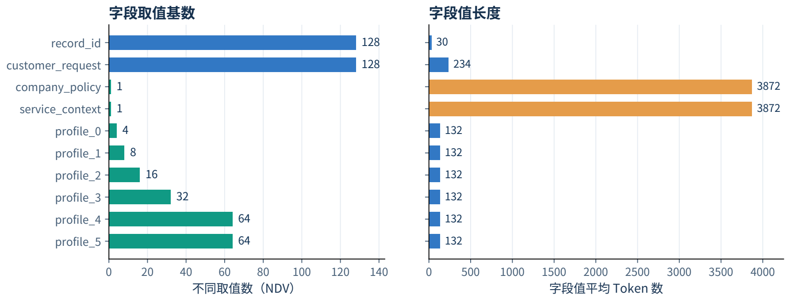
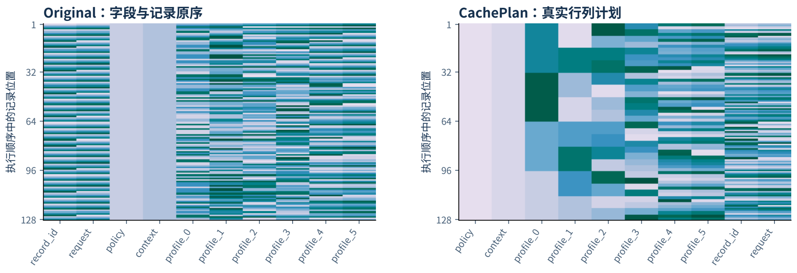

# JEV-CachePlan 布局机制

前缀缓存依赖匹配的连续 Token 前缀。在合成退款意图数据中，`record_id` 和 `customer_request` 各有 128 种取值，并且在 Original 中排在前面。97% 核心数据里，`company_policy`、`service_context` 各只有一种取值，各字段平均 3,872 Token。将它们前移可以延长这个负载中的共同前缀。

字段长度用于解释当前负载的收益；底层规划仍调用固定公开实现的前缀分组逻辑，没有在本项目中新增 Token 加权布局算法。

实测字段统计中的 NDV 表示不同取值数。六个 `profile_*` 字段依次有 4、8、16、32、64、64 种取值。 [原字段统计](../benchmarks/token_statistics.csv)

| 对照 | 97% 核心配置的实际字段顺序 |
| --- | --- |
| Original | `record_id` → `customer_request` → `company_policy` → `service_context` → `profile_0` … `profile_5` |
| CachePlan | `company_policy` → `service_context` → `profile_0` … `profile_5` → `record_id` → `customer_request` |

图中的行序和列序来自实测 `LayoutPlan`。颜色编码字段内相同取值，颜色跨字段没有统一语义。CachePlan 执行列重排和行分组，保留字段及内容，序列化后送入同一决策服务。执行器校验行列置换为双射，返回结果按源位置与 ID 恢复。 [完整布局计划](../benchmarks/results/layout_plans.json) · [执行与验证架构](architecture.md)

布局方法来自公开的前缀缓存感知重排工作。本项目贡献在 JEV-9B 集成、布局执行、结果校验与实际性能测量。 [方法和组件归属](third_party.md)
